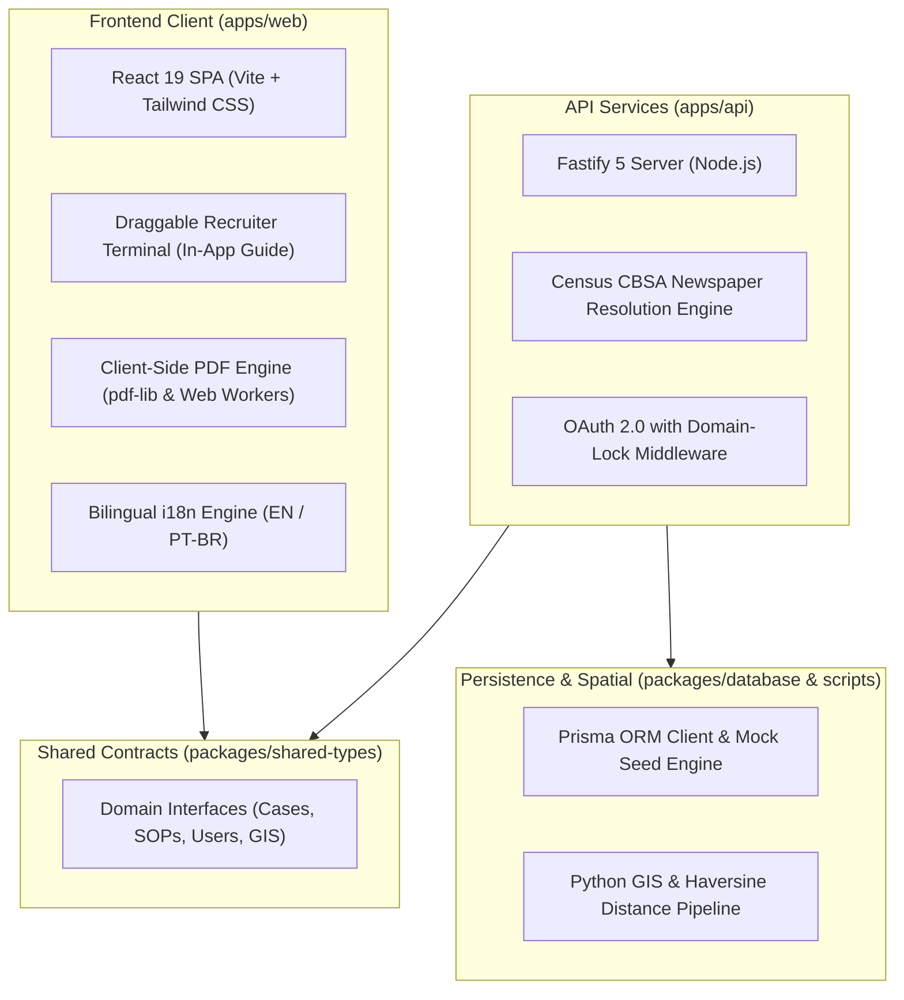

# CaseSupportDemo — Legal-Tech & USPTO Docketing Platform

[](https://case-support-demo.vercel.app)
[](https://github.com/zeCarioca/CaseSupportDemo/actions)
[](https://www.typescriptlang.org/)
[](https://react.dev/)
[](https://vitest.dev/)
[](https://turbo.build/)
[](https://fastify.dev/)
[](https://www.prisma.io/)

A full-stack, enterprise-grade operations and docketing platform engineered for modern intellectual property practices. Built with a **zero-server privacy architecture**, modular monorepo structure, automated CI pipeline, and high-performance client-side tooling.

👉 **[Launch Live Production Showcase](https://case-support-demo.vercel.app)**

---

## 1. System Architecture

The project is structured as a **Turborepo** monorepo using **pnpm workspaces**, establishing a strict boundary between presentation, domain contracts, backend business logic, and spatial algorithms.



---

## 2. Key Engineering Highlights (Recruiter Guide)

### 💼 Built-In Draggable Recruiter Terminal
- **Interactive Walkthrough**: A dark, floating CLI terminal pops up automatically on initial load to explain the exact business problem and technical architecture behind every tab.
- **Draggable & Minimizable**: Features custom pointer event physics, window minimization to an ambient launcher pill, and auto-sync with the active navigation tab.

### ⚡ Zero-Server Client-Side Document Pipeline
- **Problem**: Confidentiality rules strictly prohibit uploading unfiled trademark specimens or client documents to untrusted cloud servers.
- **Solution**: Multi-page PDF batch merging and stamp-swapping executed entirely in the client's browser memory via `pdf-lib` and typed `ArrayBuffer` pipelines.
- **One-Click Demo**: Includes a breathing **"Run Demonstration"** CTA that procedurally generates valid mock USPTO specimens on demand.

### 🌐 Algorithmic Spatial Newspaper Resolution
- **Statutory Compliance**: DOL PERM recruitment mandates publication in newspapers of general circulation within the employer's Metropolitan Statistical Area (MSA).
- **Haversine Math & CBSA Engine**: Matches employer ZIP codes against 40,000+ U.S. Census ZCTA mappings and calculates geographic proximity using spherical trigonometry.

### ⚖️ Clean Code & Architectural Rules
- **Modularity Gate**: Every source file is kept strictly **under 300 lines**, enforcing single responsibility and colocated subcomponents.
- **End-to-End Type Safety**: 100% TypeScript coverage from Prisma schema definitions to React UI props via `@case-support/shared-types`.

---

## 3. Automated Quality Assurance & Testing

The repository enforces a rigorous two-tier quality gate to prevent regressions and ensure code health:

```
[Local Commit] -> Husky Pre-Commit Hook (Lint + Vitest) -> [Push / PR] -> GitHub Actions CI -> Production Build
```

1. **Pre-Commit Enforcement (Husky)**:
   - Configured in `.husky/pre-commit` to automatically run `pnpm run lint && pnpm test` before any commit is accepted locally.
2. **Automated Unit Testing (Vitest)**:
   - Client-side procedural PDF generation, page count validation, and ArrayBuffer integrity tests (`apps/web/src/components/utilities/demo/demoPdfGenerator.test.ts`).
   - Geospatial Haversine distance and Census CBSA resolution tests (`apps/api/src/services/newspaper/haversine.test.ts`).
3. **Continuous Integration (GitHub Actions)**:
   - `.github/workflows/ci.yml` runs on every `push` and `pull_request` against `main` on Node 22 with cached dependencies, executing lint, test, and production builds.

---

## 4. Monorepo Workspaces

| Workspace | Technology | Responsibility |
|---|---|---|
| `apps/web` | React 19, Vite, Tailwind CSS, Lucide | Responsive legal workspace, SOP flowchart, PDF utilities, recruiter terminal |
| `apps/api` | Fastify 5, TypeScript | REST API, Google Workspace SSO domain lock, CBSA newspaper resolution |
| `packages/shared-types` | TypeScript | Canonical type definitions shared across client and server |
| `packages/database` | Prisma ORM, SQLite | Database schema, type-safe query generation, and synthetic seed datasets |
| `scripts/gis` | Python 3, Pytest | Spatial mapping pipeline, CBSA boundary classification, and Haversine math |

---

## 5. Key Architectural Decisions (ADRs)

1. **Client-Side Document Processing over Cloud Microservices**:
   - *Rationale*: Eliminates third-party data transmission risks, reduces infrastructure hosting costs to \$0 for PDF pipelines, and provides instant UI feedback with zero network latency.
2. **Turborepo Monorepo Architecture**:
   - *Rationale*: Ensures synchronous evolution of shared type contracts between frontend and backend without publishing private packages to an external registry.
3. **Decoupled Mock Presentation Layer**:
   - *Rationale*: Allows complete visual and functional exploration of proprietary workflows without requiring live backend connections or exposing private infrastructure.

---

## 6. Local Setup & Quickstart

### Prerequisites
- **Node.js**: v22.x or later
- **pnpm**: v12.x or later (`npm i -g pnpm`)

### Installation & Execution

```bash
# Clone the repository
git clone https://github.com/zeCarioca/CaseSupportDemo.git
cd CaseSupportDemo

# Install monorepo dependencies & setup pre-commit hooks
pnpm install

# Run automated Vitest test suites
pnpm test

# Run type-checking across all workspaces
pnpm run lint

# Run the frontend application (Vite on http://localhost:3000)
pnpm --filter @case-support/web dev

# Build the entire monorepo for production
pnpm build
```

---

## 7. Author & Portfolio

**Mateus Guimarães Silva**  
*Full-Stack Software Engineer*  
- GitHub: [@zeCarioca](https://github.com/zeCarioca)  
- Live Project: [https://case-support-demo.vercel.app](https://case-support-demo.vercel.app)
